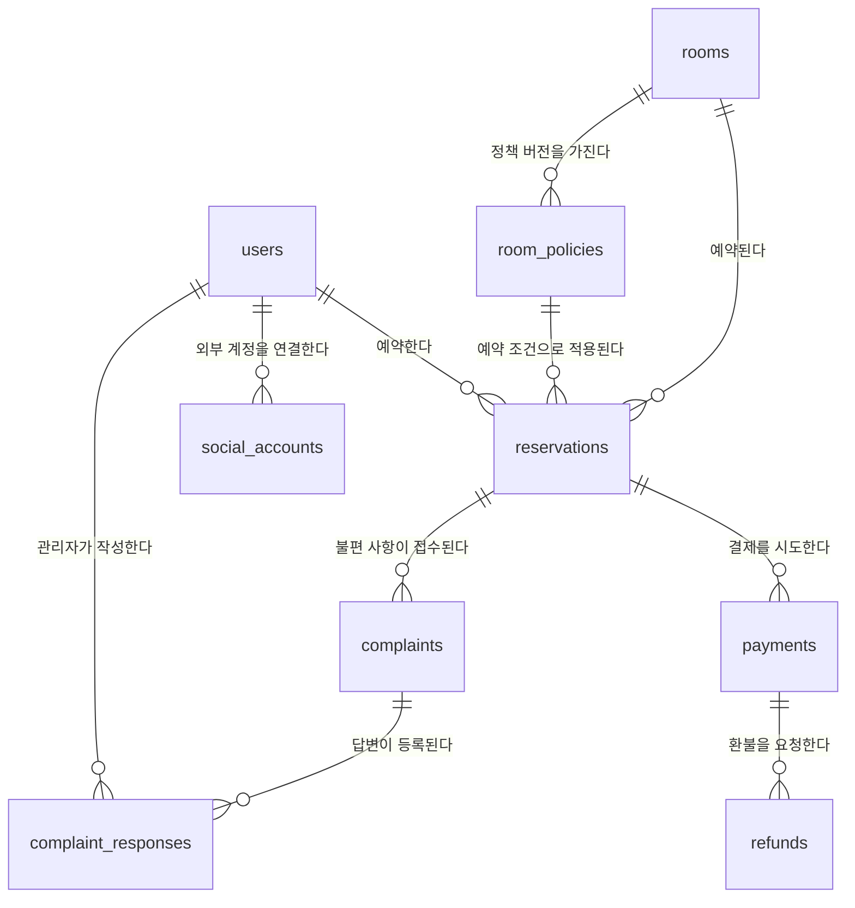

# 데이터베이스 설계

## 핵심 관계

## 테이블 역할

| 테이블 | 역할 |
|---|---|
| users | 일반 회원과 관리자 정보 |
| rooms | 방 이름과 시설 설명 |
| reservations | 누가 어떤 방을 언제 예약했는지 기록 |
| room_policies | 방별 정원·요금·운영시간·취소 기한과 적용일 |

## rooms — 공간 기본 정보

| 컬럼 | 의미 | 제약 |
|---|---|---|
| id | 방 식별자 | PK |
| name | 방 이름 | 필수 |
| description | 시설 및 공간 설명 | 필수 |
| created_at | 생성 시각 | 필수 |
| updated_at | 마지막 수정 시각 | 필수 |

정원·요금·운영시간·취소 기한은 room_policies에서 관리한다.

## room_policies — 방별 정책 버전

| 컬럼 | 의미 | 제약 |
|---|---|---|
| id | 정책 버전 식별자 | PK |
| room_id | 정책이 적용되는 방 | FK → rooms.id, 필수 |
| capacity | 최대 이용 인원 | 양수, 필수 |
| hourly_rate | 시간당 요금 | 필수, 허용 범위는 추후 결정 |
| cancellation_notice_minutes | 이용 시작 몇 분 전까지 취소 가능한지 | 기본 1440분 |
| published_at | 정책 공지 시각 | 필수 |
| effective_from | 적용 시작 이용일 | 필수 |

공지된 정책은 덮어쓰지 않고 새 버전으로 추가한다.
운영시간·예약 단위 등 나머지 항목은 다음 단계에서 보완한다.

| 컬럼 | 의미 | 제약 |
|---|---|---|
| id | 예약 식별자 | PK |
| user_id | 예약한 회원 | FK → users.id, 필수 |
| room_id | 예약한 방 | FK → rooms.id, 필수 |
| policy_id | 예약 당시 적용 정책 | FK → room_policies.id, 필수 |
| starts_at | 이용 시작 시각 | 필수 |
| ends_at | 이용 종료 시각 | 시작 시각보다 이후 |
| attendee_count | 이용 인원 | 양수, 적용 정책 정원 이하 |
| total_amount | 예약 시 확정한 총액 | 필수 |
| status | 예약 상태 | 필수 |
| expires_at | 임시 예약 만료 시각 | 임시 예약 생성 시 필수 |
| created_at | 생성 시각 | 필수 |

예약 상태: PENDING_PAYMENT / CONFIRMED / EXPIRED / CANCELLED

예약한 방과 적용 정책의 방은 같아야 한다.
취소·만료되지 않은 예약끼리는 같은 방의 이용 시간이 겹칠 수 없다.

## users — 회원

| 컬럼 | 의미 | 제약 |
|---|---|---|
| id | 내부 회원 식별자 | PK |
| name | 서비스에서 사용할 이름 | 필수 |
| role | MEMBER / ADMIN | 필수 |
| created_at | 가입 시각 | 필수 |
| updated_at | 마지막 수정 시각 | 필수 |

네이버 로그인으로 가입한 회원의 최초 권한은 MEMBER다.
이메일 로그인 병행 여부는 아직 결정하지 않았다.

## social_accounts — 외부 로그인 계정 연결

| 컬럼 | 의미 | 제약 |
|---|---|---|
| id | 연결 식별자 | PK |
| user_id | 연결된 내부 회원 | FK → users.id, 필수 |
| provider | 로그인 제공자 | NAVER |
| provider_user_id | 제공자가 발급한 사용자 식별자 | 필수 |
| created_at | 연결 시각 | 필수 |

(provider, provider_user_id) 조합은 중복될 수 없다.
이메일이 같다는 이유만으로 기존 회원과 자동 연결하지 않는다.

## payments — 결제 시도

| 컬럼 | 의미 | 제약 |
|---|---|---|
| id | 결제 시도 식별자 | PK |
| reservation_id | 결제 대상 예약 | FK → reservations.id, 필수 |
| order_id | 서버에서 생성한 결제 주문번호 | UNIQUE, 필수 |
| provider_payment_id | PG가 발급한 거래 식별자 | 결제 진행 후 확보, 초기에는 없을 수 있음 |
| amount | 해당 시도의 결제 요청 금액 | 필수 |
| currency | 통화 | 원화 KRW |
| status | 결제 처리 상태 | 필수 |
| created_at | 결제 시도 생성 시각 | 필수 |
| updated_at | 마지막 수정 시각 | 필수 |

결제 상태 초안:
CREATED / PROCESSING / SUCCEEDED / FAILED / UNKNOWN

확정 실패 후 재시도할 때 기존 예약에 새 결제 시도를 추가한다.
결과가 불명확하면 새 결제 전에 기존 거래 상태를 확인한다.
카드번호와 CVC는 저장하지 않는다.

## refunds — 환불 요청 및 결과

| 컬럼 | 의미 | 제약 |
|---|---|---|
| id | 환불 식별자 | PK |
| payment_id | 환불 대상 결제 | FK → payments.id, 필수 |
| request_id | 서버에서 생성한 환불 요청 식별자 | UNIQUE, 필수 |
| amount | 환불 요청 금액 | 필수 |
| reason | 환불 사유 | 필수 |
| status | 환불 처리 상태 | 필수 |
| created_at | 요청 생성 시각 | 필수 |
| updated_at | 마지막 수정 시각 | 필수 |

환불 상태 초안:
REQUESTED / PROCESSING / SUCCEEDED / FAILED / UNKNOWN

첫 버전에서는 실제 결제 금액의 전액 환불만 지원한다.
환불 결과가 불명확하면 기존 거래를 확인한 후 재처리한다.
같은 결제에 중복 환불이 실행되지 않도록 제어한다.

## complaints — 불편 사항

| 컬럼 | 의미 | 제약 |
|---|---|---|
| id | 접수 식별자 | PK |
| reservation_id | 관련 예약 | FK → reservations.id, 필수 |
| category | 시설 고장 / 청결 / 소음 / 기타 | 필수 |
| title | 제목 | 필수 |
| body | 접수 내용 | 필수 |
| status | RECEIVED / IN_PROGRESS / RESOLVED | 필수 |
| created_at | 접수 시각 | 필수 |
| updated_at | 마지막 수정 시각 | 필수 |

작성자는 관련 예약의 회원으로 확인한다.
작성자와 관리자만 내용을 조회할 수 있다.
구체적인 접수 가능 기간은 추후 확정한다.

## complaint_responses — 관리자 답변

| 컬럼 | 의미 | 제약 |
|---|---|---|
| id | 답변 식별자 | PK |
| complaint_id | 답변 대상 접수 | FK → complaints.id, 필수 |
| admin_id | 답변 작성 관리자 | FK → users.id, 필수 |
| body | 답변 내용 | 필수 |
| created_at | 답변 작성 시각 | 필수 |

답변 작성 시 서버에서 ADMIN 권한을 검사한다.
답변 작성만으로 예약 취소나 환불이 실행되지는 않는다.